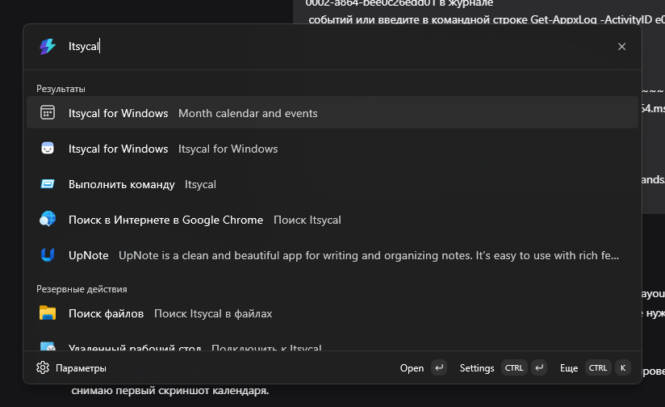
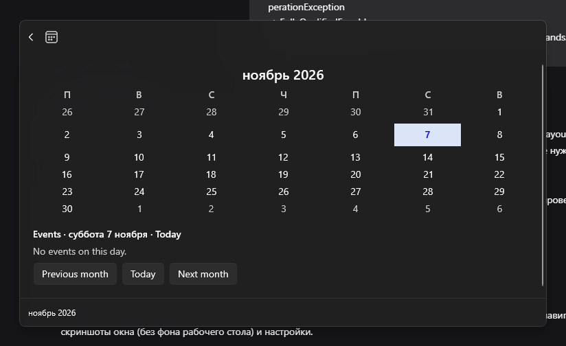

# Itsycal for Windows

A calendar for the **Windows PowerToys Command Palette Dock** — the closest Windows
equivalent of [ItsyCal](https://github.com/sfsam/itsycal)'s menu-bar calendar.

This repository contains the Windows application only. It is derived from the MIT-licensed
[ItsyCal](https://github.com/sfsam/itsycal) project by Sam Vermette and contributors; the
original macOS sources remain available upstream and in this repository's git history. The
fork relation is kept for attribution and history, not for shared code.

## Features

- **Date in the Dock** — an always-visible band at the screen edge showing today's date,
  refreshed automatically across midnight.
- **Month calendar** — one click opens a flyout with a 6×7 month grid, today highlighted,
  adjacent-month days dimmed, and previous/next/today navigation.
- **Day selection** — click a day to see that day's events; the selected day is highlighted.
- **Events** — read-only events from the local Windows calendar, with time ranges, location,
  all-day and multi-day handling; the calendar keeps working when no calendar is configured.
- **ISO week numbers** — optional week-number column (ISO-8601).
- **Settings** — dock date format, event indicator, first day of the week, week numbers,
  applied without restarting the extension.
- **Private by design** — no network calls, no telemetry, calendar data never leaves the
  machine.

## Requirements

| Requirement | Version |
|---|---|
| Windows | 10 2004 (build 19041) or newer |
| PowerToys | 0.102 or newer, with Command Palette enabled |

The MSIX package carries the .NET runtime it needs; no separate runtime installation is
required.

## Install

The current public build is a **development pre-release** — a signed MSIX for x64 and ARM64
that is self-contained (it carries its own .NET runtime, no separate installation needed):

1. Open the [releases page](https://github.com/Folieson/itsycal-for-windows/releases) and
   download the newest x64 (or arm64) MSIX together with its matching `_dev.cer`.
2. From an **elevated** PowerShell, trust the development certificate once and register the
   package:

   ```powershell
   Import-Certificate -FilePath .\ItsycalForWindows_<version>_dev.cer -CertStoreLocation Cert:\LocalMachine\TrustedPeople
   Add-AppxPackage -Path .\ItsycalForWindows_<version>_x64.msix
   ```

3. Open **Command Palette → Dock settings** and enable the **Itsycal for Windows** band.

Newer builds install over the previous package in place: each build stamps a higher package
revision, so no uninstall step is needed. The build is a pre-release because it is signed
with a development certificate. `winget install Folieson.ItsycalForWindows` becomes the
primary path once a trusted (free open-source) code-signing certificate is in place; the
staged WinGet manifests in [`winget/`](winget) already carry the release URLs and hashes, and
[`docs/SIGNING.md`](docs/SIGNING.md) documents the signing options.
## Screenshots

| Command Palette | Calendar flyout |
|---|---|
|  |  |

Captured from the installed 1.0.0 development build. The extension follows the Windows
display language, the first day of week and the week-number setting: the screenshots above
show a Russian locale and weeks starting on Monday. The flyout marks days that have events
with a dot, shows today with the accent colour, and lists the selected day's events with
their time, title, and location. The visible events come from a temporary "Itsycal demo"
calendar that the DEBUG build can create with the `Itsycal: add demo events` command and
remove again with `Itsycal: remove demo events` — release builds ship neither the commands
nor the demo calendar.

## Build from source

Requires the .NET 10 SDK, the Windows SDK 10.0.26100 and Visual Studio Build Tools for MSIX
packaging.

```powershell
dotnet build windows/ItsycalForWindows.sln -c Debug -p:Platform=x64
dotnet test  windows/tests/ItsycalForWindows.Tests.csproj -c Debug
```

Release packaging and signing are described in [windows/README.md](windows/README.md) and
implemented by [windows/scripts/Build-Release.ps1](windows/scripts/Build-Release.ps1).

## Configuration

Open the extension's command in Command Palette and choose **Settings** to configure the
dock date format, event indicator, first day of the week and ISO week numbers. Settings are
stored by Command Palette.

## Privacy

The extension reads events through the read-only Windows appointment store
(`Windows.ApplicationModel.Appointments`). It never writes to the calendar, never sends data
anywhere, and logs no event content. Access is declared with the `appointmentsSystem`
capability in the package manifest.

## Repository layout

| Path | Purpose |
|---|---|
| `windows/` | Windows extension source, tests, build and release scripts. |
| `windows/src/ItsycalForWindows/` | The Command Palette extension (C#, .NET 10, MSIX). |
| `windows/tests/` | Unit tests for the pure calendar/event logic. |
| `winget/` | WinGet manifests for the MSIX release. |
| `docs/adr/` | Architecture decision records. |
| `docs/SIGNING.md` | Code-signing options and release secrets. |

## Contributing

Read [AGENTS.md](AGENTS.md) for repository rules (human and AI contributors alike) and
[CONTRIBUTING.md](CONTRIBUTING.md), then open a pull request using the template.

## License

MIT. See [LICENSE.txt](LICENSE.txt) — it retains the upstream ItsyCal copyright. The Windows
extension skeleton is derived from the Microsoft PowerToys template; see
[windows/THIRD-PARTY-NOTICES.md](windows/THIRD-PARTY-NOTICES.md) for details.
