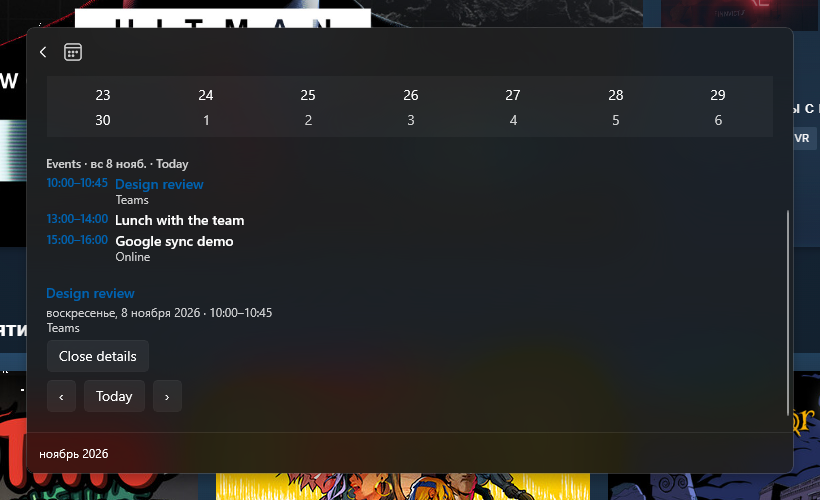

# Itsycal for Windows

A calendar for the **Windows PowerToys Command Palette Dock** — the closest Windows
equivalent of [ItsyCal](https://github.com/sfsam/itsycal)'s menu-bar calendar.

This repository contains the Windows application only. It is derived from the MIT-licensed
[ItsyCal](https://github.com/sfsam/itsycal) project by Sam Vermette and contributors; the
original macOS sources remain available upstream and in this repository's git history. The
fork relation is kept for attribution and history, not for shared code.

## Features

- **Date in the Dock** - an always-visible band at the screen edge showing today's date and
  the next event today, refreshed automatically across midnight.
- **Month calendar** - one click opens a flyout with a 6x7 month grid, today highlighted,
  adjacent-month days dimmed, event dots, and previous/next/today navigation.
- **Day selection** - click a day to see that day's events; the selected day is highlighted.
- **Event details and joining** - click an event to see the full when-line (all-day and
  multi-day aware), location, notes and a **Join meeting** action for Teams/Zoom/Google
  Meet/KTalk-style links (validated http(s) only, opened in the default browser), plus a
  copy-link fallback.
- **Multiple calendar sources** - events are merged from the local Windows appointment store
  and from any `.ics` files dropped into `%LOCALAPPDATA%\ItsycalForWindows\calendars\`. This
  covers exported Google Calendar, Outlook/Microsoft 365, Exchange, Apple Calendar and
  CalDAV data today; native Google/Microsoft/CalDAV providers are on the roadmap.
- **Self-update** - checks the project's GitHub releases (24-hour throttle, opt-in
  auto-install), shows the available version, downloads the MSIX, verifies it against
  `SHA256SUMS.txt` and installs it through a detached updater that restarts the palette.
  Manual `Itsycal: check for updates` / `Itsycal: install update` commands are always
  available.
- **ISO week numbers** - optional week-number column (ISO-8601).
- **Settings** - dock date format, event indicator, first day of the week, week numbers,
  update behaviour (auto-check/auto-install), applied without restarting the extension.
- **Private by design** - no telemetry and no event content in logs; the network is used
  only when you enable update checks or (in future) a remote calendar provider.

## Requirements
## Requirements

| Requirement | Version |
|---|---|
| Windows | 10 2004 (build 19041) or newer |
| PowerToys | 0.102 or newer, with Command Palette enabled |

The MSIX package carries the .NET runtime it needs; no separate runtime installation is
required.

## Install

The current public build is a **development pre-release** — a signed MSIX for x64 and ARM64
that is self-contained (it carries its own .NET runtime, no separate installation needed):

1. Open the [releases page](https://github.com/Folieson/itsycal-for-windows/releases) and
   download the newest x64 (or arm64) MSIX together with its matching `_dev.cer`.
2. From an **elevated** PowerShell, trust the development certificate once and register the
   package:

   ```powershell
   Import-Certificate -FilePath .\ItsycalForWindows_<version>_dev.cer -CertStoreLocation Cert:\LocalMachine\TrustedPeople
   Add-AppxPackage -Path .\ItsycalForWindows_<version>_x64.msix
   ```

3. Open **Command Palette → Dock settings** and enable the **Itsycal for Windows** band.

Newer builds install over the previous package in place: each build stamps a higher package
revision, so no uninstall step is needed. Close Command Palette before installing an upgrade —
the running host holds the package files. The build is a pre-release because it is signed
with a development certificate. `winget install Folieson.ItsycalForWindows` becomes the
primary path once a trusted (free open-source) code-signing certificate is in place; the
staged WinGet manifests in [`winget/`](winget) already carry the release URLs and hashes, and
[`docs/SIGNING.md`](docs/SIGNING.md) documents the signing options.
## Screenshots

| Command Palette | Calendar flyout |
|---|---|
|  |  |

| Event details | |
|---|---|
|  | Clicking an event expands its details under the agenda: full when-line, location, notes and the Join meeting / Copy link actions for events that carry a meeting URL. |

| Command Palette | Calendar flyout |
|---|---|
|  |  |
\n\|\ Event\ details\ \|\ \|\n\|---\|---\|\n\|\ !\[Inline\ event\ details\ with\ the\ selected\ event\ expanded\ below\ the\ agenda]\(docs/screenshots/event-details\.png\)\ \|\ Clicking\ an\ event\ expands\ its\ details\ under\ the\ agenda:\ full\ when-line,\ location,\ notes\ and\ the\ Join\ meeting\ /\ Copy\ link\ actions\ for\ events\ that\ carry\ a\ meeting\ URL\.\ \|\n
Captured from the installed 1.0.0 development build. The extension follows the Windows
display language, the first day of week and the week-number setting: the screenshots above
show a Russian locale and weeks starting on Monday. The flyout marks days that have events
with a dot, shows today with the accent colour, and lists the selected day's events with
their time, title, and location. The visible events come from a temporary "Itsycal demo"
calendar that the DEBUG build can create with the `Itsycal: add demo events` command and
remove again with `Itsycal: remove demo events` — release builds ship neither the commands
nor the demo calendar.

## Build from source

Requires the .NET 10 SDK, the Windows SDK 10.0.26100 and Visual Studio Build Tools for MSIX
packaging.

```powershell
dotnet build windows/ItsycalForWindows.sln -c Debug -p:Platform=x64
dotnet test  windows/tests/ItsycalForWindows.Tests.csproj -c Debug
```

Release packaging and signing are described in [windows/README.md](windows/README.md) and
implemented by [windows/scripts/Build-Release.ps1](windows/scripts/Build-Release.ps1).

## Configuration

Open the extension's command in Command Palette and choose **Settings** to configure the
dock date format, event indicator, first day of the week and ISO week numbers. Settings are
stored by Command Palette.

## Privacy

The extension reads events from sources you choose: the read-only Windows appointment store
(`Windows.ApplicationModel.Appointments`) and `.ics` files in your local calendar folder. It
never writes to calendars and never logs event content.

Network access is deliberately narrow and documented in
[ADR 0002](docs/adr/0002-calendar-providers-and-network.md):

- update checks query the project's GitHub releases only (and only when auto-check/manual
  update is enabled); no telemetry, no identifiers, no calendar data;
- future remote providers (Google Calendar, Microsoft Graph/Exchange, CalDAV) are opt-in per
  provider, use HTTPS, and store credentials encrypted with Windows DPAPI. Until such a
  provider is enabled, the extension makes no network requests for calendars.

The Windows store access is declared with the `appointmentsSystem` capability in the package
manifest.
## Roadmap

Provider plans (Google Calendar, Microsoft Graph/Exchange, CalDAV), the modern-UI pass and
the distribution milestones live in [docs/ROADMAP.md](docs/ROADMAP.md).

## Repository layout

| Path | Purpose |
|---|---|
| `windows/` | Windows extension source, tests, build and release scripts. |
| `windows/src/ItsycalForWindows/` | The Command Palette extension (C#, .NET 10, MSIX). |
| `windows/tests/` | Unit tests for the pure calendar/event logic. |
| `winget/` | WinGet manifests for the MSIX release. |
| `docs/adr/` | Architecture decision records. |
| `docs/SIGNING.md` | Code-signing options and release secrets. |
| `docs/ROADMAP.md` | Milestones, provider plans and the sequenced backlog. |

## Contributing

Read [AGENTS.md](AGENTS.md) for repository rules (human and AI contributors alike) and
[CONTRIBUTING.md](CONTRIBUTING.md), then open a pull request using the template.

## License

MIT. See [LICENSE.txt](LICENSE.txt) — it retains the upstream ItsyCal copyright. The Windows
extension skeleton is derived from the Microsoft PowerToys template; see
[windows/THIRD-PARTY-NOTICES.md](windows/THIRD-PARTY-NOTICES.md) for details.
